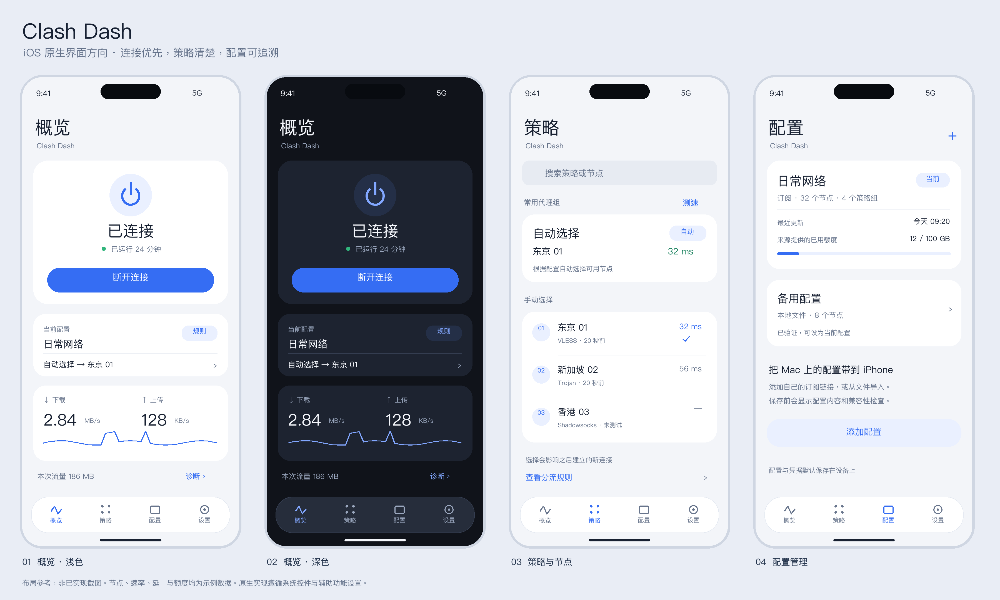

# Clash Dash 产品设计与技术实施规划

版本 1.0　｜　2026 年 10 月 24 日　｜　面向产品设计和 iOS 实现 Agent

Clash Dash 的首个目标是在用户自己的 iPhone 上运行一个稳定、清楚、精致的原生代理客户端，沿用 Clash Verge Rev 所使用的 mihomo 配置体系与核心网络能力。采用 SwiftUI 构建界面，通过 Network Extension 承载网络核心。先验证签名、真实数据通路和资源占用，再完成日常使用体验，最后单独评估公开发布。

用户已明确选择“先在自己的 iPhone 上运行，再考虑发布”。本规划给出了功能范围、页面规格、交互状态、技术边界、模块契约和验收标准。除标注为“已核实”的环境与来源事实外，版本范围、性能目标、默认值和工期均为项目建议，需要在首轮验证后调整。

本文件保留最初的规划与设计规格。工程实施已经开始，最新完成情况、测试证据和剩余限制见 [实施与验证记录](IMPLEMENTATION_STATUS.md)。当前尚未通过 iPhone VPN 真机验收，不应将规划中的功能都视为已实现。

## 1 产品决策和当前环境

### 1.1 推荐决策

1. 产品定位为“可导入 Clash 配置的 iOS 原生网络客户端”，核心价值是可靠连接、快速选策略、清楚解释连接问题。
2. 主界面采用“概览、策略、配置、设置”四个 Tab。连接详情、规则与日志进入二级页面。
3. 采用 SwiftUI、Swift Concurrency、Network Extension、App Group 和 Keychain；网络核心优先评估 mihomo 的 Apple 适配实现。
4. 将上游引擎包在项目自有的 CoreBridge 接口后。页面不直接依赖 Go 绑定、HTTP 控制器或具体核心版本。
5. 第一版保留订阅、节点与代理组、规则模式、DNS、连接信息和诊断；桌面窗口、托盘、系统代理开关、后台服务安装器等不移植。
6. 先解决真机网络路径。模拟器中漂亮的页面、可点击的开关、VPN 图标出现，都不能单独证明成功。
7. 不设置自建账号体系或云端转发服务。订阅、配置、代理连接由用户选择的服务提供；App 本身不附送节点。

### 1.2 已核实的本地环境

| 项目 | 本次读取结果 | 对实施的影响 |
| --- | --- | --- |
| 工作目录 | `/Users/dongyuan/Documents/Apple/ClashDash`，原为空目录且尚非 Git 仓库 | 可建立新工程；后续初始化 Git 不等于获得提交或推送授权 |
| Mac 客户端 | Clash Verge Rev 2.5.8 | 桌面功能对照使用这一版本 |
| Bundle ID | `io.github.clash-verge-rev.clash-verge-rev` | 确认是 Rev 分支，而非早期已停止维护的同名项目 |
| 内置稳定核心 | Mihomo Meta v1.19.32，darwin arm64，构建含 `with_gvisor` | 桌面二进制不能直接链接进 iOS |
| Xcode | 26.6，Build 17F113 | 当前安装情况，不等于满足所有依赖要求 |
| iOS SDK | 26.5 | 新的 SwiftUI API 需要 availability 检查 |
| 已配对手机 | 型号标识 iPhone16,2；工具报告 iOS 27.2 | 必须先验证当前 Xcode 的设备支持与实际安装能力 |
| 开发状态 | Developer Mode 已开启；设备已配对；查询时开发通道为 disconnected | 已配对不代表当前可调试；解锁手机并在 Xcode 确认连接 |
| 开发者账户 | 尚未验证 Team、证书、描述文件和可用 entitlement | G0 必查，不能假定免费 Personal Team 足够 |

环境信息仅用于开发预检，不记录设备名称、UDID、序列号、订阅地址或节点密码。设备 OS 高于本地 SDK 是一个需要验证的兼容性条件，不能仅根据版本差异断言一定能或一定不能安装。

### 1.3 成功的具体样子

用户从 Mac 获取自己的订阅 URL 或最终生成的标准 mihomo YAML，在 Clash Dash 中预览并导入，允许添加 VPN 配置后连接。随后能在 Safari 和另一个应用中访问测试目标，切换策略后新连接按新选择路由；锁屏、回到前台、Wi-Fi 与蜂窝切换后状态正确。配置更新失败时继续使用上次可用版本。

界面能够明确回答四个问题：现在是否连接、当前配置和策略是什么、最近一次检查是否可用、发生故障后下一步应该做什么。

## 2 Clash Verge 能力拆解与 iOS 取舍

Clash Verge Rev 是管理界面与桌面集成层，mihomo 是协议、DNS、规则和代理组的执行核心。上游 v2.5.8 的功能说明包括 Tauri 2、内置核心、配置增强、系统代理、TUN、节点与规则编辑、WebDAV；源码页面还覆盖概览、连接、日志和设置。[Clash Verge Rev v2.5.8](https://github.com/clash-verge-rev/clash-verge-rev/tree/v2.5.8)

下面的迁移决策是 Clash Dash 的产品设计，并非声明所有桌面能力都能在 iOS 上等价运行。P0 为个人真机首版；P1 为稳定后增强；P2 为后续探索。

| 桌面能力 | iOS 处理方式 | 优先级 |
| --- | --- | --- |
| 一键启停核心 | 用系统 VPN 生命周期控制隧道，界面同时呈现可用性 | P0 |
| HTTP 和 SOCKS 系统代理 | 不提供桌面式“系统代理”开关；以 Packet Tunnel 为连接入口 | 不移植 |
| TUN 模式开关 | 隧道是 iOS 数据入口，不能包装成随意切换的桌面网卡选项 | P0 内部能力 |
| 订阅 URL 和本地 YAML | 支持安全导入、预览、校验、更新、切换、回滚 | P0 |
| 多配置管理 | 支持多个配置，但只有一个活动配置与一个运行实例 | P0 |
| 节点和代理组 | 保留 select、url-test、fallback 等模型；展示不同可操作性 | P0 |
| 节点延迟测试 | 通过核心执行指定探测；限并发，显示时间戳 | P0 |
| 规则和全局模式 | 保留核心模式语义；全局模式不等于设备所有系统流量必经代理 | P0 |
| DIRECT 和规则分流 | 个人 PoC 验证；区分系统排除路由和核心内直连路径 | P0 验证项 |
| 规则列表和命中原因 | 搜索规则、查看命中的规则类型与出站链 | P0 |
| 可视化规则编辑 | 初期仅允许有限本地覆盖；完整编辑器后置 | P1 |
| proxy providers 和 rule providers | 版本化缓存、下载校验、更新回滚；不能只支持静态节点 | P0 |
| DNS 和 Fake IP | 适配虚拟 DNS、IPv6 和网络变化；配置合法不等于移动端可用 | P0 |
| 实时流量与连接列表 | 展示核心观测到的流量，限频、分页、脱敏 | P0 |
| 进程名和进程路径规则 | 普通 iOS Packet Tunnel 不提供桌面等价进程身份 | 不承诺 |
| 给任意 App 单独配置代理 | per-app VPN 有管理设备条件，不能作为普通个人设备功能 | 不提供 |
| 日志 | 默认精简且短期保留；按需开启详细诊断 | P0 |
| Merge 和 Script | 保留原始文件与覆盖概念；首版不执行任意 JS 脚本 | Merge 子集 P1 |
| CSS 注入和自定义窗口 | 用原生主题、系统字体、语义颜色替代 | 不移植 |
| WebDAV 备份 | 首版支持显式文件导出；加密同步另立需求 | P2 |
| 内核 Alpha 切换和在线更新 | 核心随签名 App 发版，不能运行下载的新可执行核心 | 不移植 |
| 开机启动和服务守护 | 用系统支持的 On Demand；不模拟桌面守护服务 | P1 |
| LAN 代理共享和路由器功能 | 不把隧道扩展当公网或局域网代理服务器 | 不提供 |
| 快捷键和托盘 | 以后映射为 App Intents、快捷指令和控制入口 | P1 |

Apple 的部署文档明确指出 iOS Packet Tunnel 的 per-app 模式要求受管理设备；本项目面向普通个人 iPhone。[TN3134](https://developer.apple.com/documentation/technotes/tn3134-network-extension-provider-deployment)

## 3 用户需求与版本范围

### 3.1 按日常使用频率排序

以下排序来自本项目的使用场景判断，尚不是用户调研结论。验证时观察用户能否不阅读说明完成操作，再调整优先级。

| 用户任务 | 需要提供的体验 | 首版验收 |
| --- | --- | --- |
| 想让手机联网 | 首屏主按钮，连接过程和失败原因可见 | 有配置后一次点击启动，系统授权除外 |
| 当前节点不稳定 | 首屏打开当前策略，搜索或选择替代节点 | 从概览到完成选择不超过三次主动点击 |
| 从 Mac 迁移 | 粘贴订阅或导入最终 YAML，预览实际差异 | 导入前知道哪些字段被保留、覆盖或拒绝 |
| 想知道为什么慢 | 分开呈现节点探测、流量速度、网络可达性 | 不把延迟低等同于带宽高 |
| 订阅失效或额度不足 | 显示来源更新时间、可用字段、更新错误 | 未提供额度时显示“来源未提供” |
| 配置更新后坏了 | 保留旧版本，显示新版本未应用 | 一键回滚不需要重新输入订阅 |
| 锁屏后继续用 | 隧道由系统管理，主 App 不承担保活 | 后台与锁屏测试有设备记录 |
| 希望设置少一点 | 常用操作优先；高级项目逐级展开 | 初次连接不要求理解 TUN、MTU 或路由表 |

### 3.2 P0 必须交付

P0 包含原生四 Tab、首次使用引导、订阅和 YAML 导入、配置预览与校验、VPN 启停、代理组选择、按需延迟测试、规则模式和全局模式、只读规则搜索、DNS 运行方案、连接摘要、诊断、更新与回滚、深浅色和基础无障碍。

最小协议验收先选择用户实际配置需要的协议。候选协议包括 Shadowsocks、Trojan、VMess、VLESS、Hysteria2、TUIC；每项都必须登记“解析通过、握手通过、TCP 通过、UDP 适用性、IPv6 适用性”。只有完成验证的组合才能进入首版支持清单。Reality、不同传输层与协议版本分开记录，不用一个“支持 VLESS”替代全部组合测试。

P0 不包含账号系统、订阅销售、购买节点、网络解锁检测、在线脚本执行、跨设备同步、全功能 YAML IDE、Mac 远程控制面板。文件导出保留作为手动迁移手段，必须明确包含敏感信息。

### 3.3 后续增强

P1 依次考虑 On Demand、收藏策略、有限规则覆盖、节点 QR 导入、App Intents、配置分享导入、Widget 或控制中心入口、iPad 适配。核心运行仍只有一个入口，系统集成通过同一状态机操作。

P2 再评估加密 WebDAV 或 iCloud 同步、复杂配置编辑和 Mac 联动。未经单独设计，不把用户的订阅 URL 上传到任何转换站，也不新增遥测后端。

## 4 信息架构

```text
Clash Dash
├─ 概览
│  ├─ 连接与当前配置
│  ├─ 当前策略快速选择
│  ├─ 本次流量与连接详情
│  └─ 运行诊断
├─ 策略
│  ├─ 代理组列表
│  ├─ 代理组详情与节点选择
│  └─ 规则列表与规则解释
├─ 配置
│  ├─ 配置列表与活动状态
│  ├─ 添加与导入预览
│  └─ 配置详情、更新历史、回滚
└─ 设置
   ├─ 连接行为与 DNS
   ├─ 外观与辅助功能
   ├─ 诊断、日志、存储管理
   └─ 隐私、开源许可、版本
```

每个 Tab 保留自己的导航路径、滚动位置和筛选条件。连接按钮是操作，不占一个 Tab。底部 Tab 始终保留文字标签；详细日志不提升到主导航，避免让日常用户先面对诊断工具。[Apple Tab bars](https://developer.apple.com/design/human-interface-guidelines/tab-bars)

概览里的“当前策略”不是所有配置都存在的固定代理组名称。用户第一次导入时可选一个常用 select 组作为快捷入口；没有可选择组时展示配置定义的自动策略，不虚构一个 GLOBAL 组。

## 5 视觉方向与设计系统

### 5.1 视觉概念

整体采用浅色系统背景、清楚的文字层级、适量留白和少量蓝色强调。首屏用一个具有辨识度的连接模块承载状态，其他区域回归克制的原生列表。深色模式使用系统语义背景，避免所有元素都发光或带彩色描边。

Liquid Glass 主要交给系统导航栏、Tab 栏和需要浮于内容之上的控件。配置正文、列表和图表保持稳定、可读的内容层；不在每张卡片上叠加玻璃，也不自行复刻系统 Tab 栏。[Apple Liquid Glass](https://developer.apple.com/documentation/technologyoverviews/liquid-glass)

附图为布局和视觉方向参考，数据均为示例，不是已运行 App 的截图。原生实现以系统控件、字体缩放、安全区和实际内容为准。



### 5.2 设计变量

| 类别 | 建议规则 | SwiftUI 实现方向 |
| --- | --- | --- |
| 页面背景 | 系统分组背景；深浅色语义切换 | `systemGroupedBackground` |
| 内容表面 | 次级分组背景，减少阴影 | `secondarySystemGroupedBackground` |
| 品牌色 | 蓝色为主；图稿参考 #356DF3，实际按对比度调整 | Asset Catalog 的 light、dark、high contrast 变体 |
| 状态色 | 蓝为操作，绿为已连接，橙为需注意，红为失败 | 颜色始终与文字和图标同时使用 |
| 字体 | 标题 largeTitle/title2；正文 body；说明 footnote | 系统字体与 Dynamic Type |
| 数字 | 速度和流量使用等宽数字 | `monospacedDigit()`，单位与数值分层 |
| 间距 | 4、8、12、16、24、32 pt；页面常用 20 pt | 作为项目变量，布局可自适应 |
| 圆角 | 内容模块约 20 至 24 pt；主要操作跟随系统胶囊 | 图稿值不是设备上的固定像素 |
| 触控 | 常规触控目标至少 44×44 pt；主要按钮约 56 pt 高 | 包括图标按钮的可点击区域 |
| 图标 | SF Symbols；自定义品牌标志独立绘制 | 系统符号按名称引用，检查目标系统可用性 |
| 图表 | 低干扰折线和清楚单位；无数据时不用零假装采样 | Swift Charts 或轻量 Path，配文本替代 |

正文尽量满足 4.5:1 对比度，大字至少 3:1。最大辅助字号下卡片转为纵向；节点名允许换行，状态与操作不被挤掉。支持 VoiceOver、减少动态效果、减少透明度、提高对比度，并在深浅色下分别验证。[Apple Accessibility](https://developer.apple.com/design/human-interface-guidelines/accessibility)

### 5.3 首屏布局

顶部是系统大标题“概览”，下面是连接模块：状态图标、状态文字、持续时间、一个主按钮。模块高度根据文字扩展，不让一个巨大装饰圆环占满屏幕。

其后依次是“当前配置与常用策略”“上传与下载速度”“本次会话摘要”。测速、连接详情和诊断是明确的次级入口。额度仅在来源提供时出现；不把所有用户都没有的数据做成永久占位卡。

状态术语固定为“未连接、正在连接、已连接、正在恢复、正在断开、连接失败”。隧道已连接但探测失败时显示“已连接 · 网络检查未通过”，不直接把 VPN 状态改成未连接。

### 5.4 品牌与平台观感

App 名称使用 Clash Dash；不沿用 Clash Verge 的图标、截图、商标性文案或暗示官方授权。图标方向建议用简洁的连接路径与字母 D 的负空间构成，适配系统外观。图标最终设计、名称可用性与商标核查属于发布阶段事项。

避免把“极速、完全匿名、绝不泄漏、永久在线”作为默认文案。界面表达系统和内核能观测的状态，不暗示超出能力的安全保证。

## 6 页面规格

### 6.1 概览

**目的。** 一眼判断状态并完成连接或进入常用策略。

**内容。** 连接状态、活动配置名、常用代理组及其实际叶子节点、核心模式、会话时长、上下行速度、本次隧道累计流量、最近检查结果。速率单位采用 B/s、KB/s、MB/s，累计单位采用 B、KB、MB、GB，并在实现中固定十进制或二进制口径，不混用。

**操作。** 未配置时主按钮为“添加配置”；已配置未连接为“连接”；连接中为“取消连接”；已连接为“断开”。点击当前策略打开原生 Sheet；点击流量进入连接详情；错误卡给出“重试”与“查看原因”。

**边界。** 未采样显示“—”；采样得到零才显示 0。后台回前台先重载系统状态和扩展快照；数据尚未同步时显示“正在同步状态”。持续时间从扩展会话开始时间计算，不能由页面出现时重新计时。统计限定为核心看到的流量，不宣称整个设备用量。

### 6.2 策略列表

**内容。** 顶部可搜索代理组与节点；模式入口使用当前模式摘要，展开后解释规则模式和全局模式。代理组卡显示名称、类型、当前选择和健康摘要。原始组名保留，允许界面显示昵称但不能改写引用。

**操作。** select 组可手动选择；url-test 和 fallback 默认展示自动策略与当前结果；load-balance 展示分配策略，不伪装为唯一活动节点。组内包含其他组时，显示“自动选择 → 东京 01”这类链路，并检测循环引用。

**边界。** 搜索、切换和刷新使用稳定 ID。节点刷新或排序后，手指所在行不会因测速完成突然移动；默认保持来源顺序，用户主动选择“按延迟排序”后才重排。不得对每个节点不断后台测速。

### 6.3 代理组详情与快速选择

每行包含节点名、协议缩写、最近延迟、测试时间、当前选中标记。地区信息仅从配置显式字段或名称推导，推导结果不得作为已验证服务器所在地；国旗不是主要识别方式。

点击节点后该行进入“正在切换”，收到扩展确认并重新读取选择后再显示选中。失败保留原节点并给出可恢复错误。切换只承诺影响新连接；已有 TCP、UDP 会话可能继续沿原路径。提供明确的“关闭旧连接”次级操作，不自动断掉用户下载。

“测试延迟”使用项目配置的探测 URL，通过指定节点或代理组发出请求；展示的是这一探测的往返表现，不是 ICMP Ping、吞吐或某网站解锁能力。未连接时 P0 提示连接后再测试，避免在主 App 中启动第二套网络核心。

### 6.4 配置列表

每项包含名称、类型、节点及策略组数量、最近成功更新时间、活动标记、订阅状态。到期时间和流量额度解析来源提供的元数据；字段缺失、非法、时区不明或已过期分别显示，不把缺失视为无限流量。

右上角添加菜单提供“订阅链接”和“从文件导入”。下拉刷新更新用户选择的订阅；批量更新必须显示进度且支持取消。配置卡的“设为当前配置”与“更新来源”是不同动作。

删除非活动配置可使用带撤销的列表删除。删除运行中的配置先说明将断开连接，再由用户确认；如果可以直接切换到另一个有效配置，则给出该路径。删除不影响其他配置的缓存、选择或覆盖。

### 6.5 添加和导入预览

流程为选择来源、读取、校验、预览、保存；保存后提供“立即连接”，不在扫描或粘贴后立刻改变网络。

预览展示配置名、节点数、策略组数、规则数、远程资源数量、主要协议、兼容性警告。兼容性结果分为“支持”“由 iOS 运行设置接管”“不支持且会阻止应用”“可选功能未验证”。脚本、进程规则、绝对路径、桌面监听端口必须明确处理，不能静默删除后显示全部兼容。

使用系统文件选择器和 `PasteButton` 或用户主动粘贴操作。不在启动时读取剪贴板。扫码为 P1，只有用户选择扫码时申请相机权限。展示订阅 URL 时默认遮蔽 token 与查询参数；可以显式查看，但不写入普通日志。

### 6.6 配置详情与更新历史

提供来源、更新时间、原始配置摘要、本地覆盖、兼容性报告、历史版本和应用状态。明确区分“已下载版本”“已验证版本”“当前正在运行版本”。

更新成功但尚未应用时显示“新版本已准备好”；运行中需要重启的修改提示短暂中断。保留至少最近三个可用版本，按存储预算清理。更新失败保留旧版本，错误中显示发生在下载、解析、资源准备还是应用阶段。

P0 的原始 YAML 以只读文本查看为主；从详情显式导出时提示文件可能包含凭据。轻量编辑作为 P1，以结构化字段和变更预览优先。

### 6.7 规则与连接详情

规则页显示顺序、类型、条件、目标策略和来源，支持搜索。规则按顺序匹配；调换顺序会改变行为。首版只读，不承诺把所有 rule-set 展开到内存中。

连接列表包含目标域名或 IP、协议、命中规则、出站链、上下行字节和建立时间；只显示核心确实提供的信息。普通 iOS 上不标注“来自 Safari/微信”等未经证实的 App 名称。

点击连接进入详情，可关闭该连接；“关闭全部”需要确认，并说明可能中断通话或下载。列表为当前会话的有限快照，不默认记录长期浏览历史。

### 6.8 诊断

诊断以可理解的阶段呈现：系统 VPN 配置、扩展响应、配置版本、网络接口、DNS 查询、指定节点握手、测试 URL 请求。用户可以重新检查其中一项，不强制每次重做所有检查。

结果显示具体检查目标、时间、耗时和边界。出口 IP 检查使用用户主动发起的公开服务请求，披露会向该服务暴露出口 IP；不在每次页面打开时调用第三方定位服务。没有第三方检查也应能判断本地配置和隧道故障。

“导出诊断”生成用户可预览的脱敏摘要，包含版本、错误阶段、资源峰值、配置计数和最近事件，不包含订阅 URL、认证头、节点密钥、完整域名历史或设备唯一标识。

### 6.9 设置

分组为连接、外观、数据与隐私、诊断、关于。常规用户看到语言、外观、更新行为、诊断和版本；DNS 高级参数、MTU、日志级别放在明确的高级页。

P0 默认手动连接。On Demand 后续开启前解释触发条件、手动断开的效果与可能的耗电。局域网访问策略使用清楚说明；不把“允许局域网”混同于向局域网开放代理端口。

设置底部显示 App 版本、配置格式版本、核心版本、构建标识和许可证入口，便于定位问题。调试开关和内部错误码不占据日常使用页面。

### 6.10 首次使用和权限

欢迎页用一屏说明：App 管理用户提供的网络配置，流量将按配置连接到对应服务器，配置默认保存在设备上。接着进入添加配置，不展示冗长轮播。

只有用户第一次点击连接时才准备系统 VPN 配置并触发授权。取消授权后回到可操作状态，保留已导入配置；不反复弹系统请求。联网权限受设备地区与系统设置影响，网络访问被拒绝时给出设置指引，不误判为节点故障。

不申请通讯录、位置、照片库或通知权限来完成基础连接。需要局域网服务发现、扫码或通知的后续功能，单独按场景申请。

## 7 交互状态与反馈

### 7.1 两层状态模型

系统连接状态与网络可用性必须分开。`NEVPNStatus.connected` 证明系统连接处于已连接状态，不能保证 DNS、远端服务或特定网站可用。网络可用性使用 unknown、checking、healthy、degraded、unreachable 五种项目状态，并附探测时间。

```text
未配置 → 导入并校验 → 就绪
就绪 → 用户连接 → 请求系统授权 → 正在连接
正在连接 → 扩展启动和设置成功 → 已连接
正在连接 → 超时或失败 → 连接失败 → 重试或修复配置
正在连接 → 用户取消 → 正在断开 → 就绪
已连接 → 网络变化 → 正在恢复 → 已连接或连接失败
已连接 → 用户断开 → 正在断开 → 就绪
任意前台状态 → 重读系统状态和扩展快照 → 对齐实际状态
```

UI 状态由系统状态、扩展健康、用户意图和当前操作共同派生；不把每个页面的布尔值拼成连接逻辑。每个启动、停止和配置应用操作具有 requestId 与 generation，晚到的旧回调不能覆盖新状态。

### 7.2 操作反馈合同

| 操作 | 立即反馈 | 最终确认 | 失败处理 |
| --- | --- | --- | --- |
| 连接 | 按钮进入进度态，显示可取消 | 系统状态与扩展会话均确认 | 保留配置，给出错误阶段 |
| 断开 | 显示正在断开，拦截重复点击 | 系统 disconnected；必要时再次查询 | 超时提示检查状态，不假装已断开 |
| 选择节点 | 行内小进度，不阻断整屏 | 扩展回执及实际选择一致 | 回到原选择，允许重试 |
| 更新订阅 | 卡片显示更新进度 | 新版本完成校验和资源准备 | 保留旧版本，展示失败原因 |
| 切换配置 | 展示变更与是否需重启 | 运行 generation 对应新版本 | 冷启动回滚到旧版本 |
| 延迟测试 | 逐项进度，可取消 | 每项带时间戳和失败类别 | timeout 不当成 0 ms |
| 修改模式 | 显示应用中 | 读取核心实际模式 | 恢复旧模式 |
| 导出诊断 | 生成本地预览 | 用户打开系统分享面板 | 无隐式上传或发送 |

### 7.3 错误文案

采用“发生了什么＋下一步”格式。例如：“配置无法解析，第 24 行缺少冒号。请修正文件后重新导入。”“节点握手超时。可以切换节点或查看网络检查。”“已下载新配置，但应用失败。当前仍使用 10 月 23 日的可用版本。”

用户可理解的文案与内部错误码分离。技术详情展开后显示 code、phase、retryable 和脱敏上下文。未知错误保留诊断标识，不直接把完整 Go 错误或 YAML 内容贴到弹窗里。

## 8 动效与手势实现

动效用于解释状态和层级；网络工作时长由实际事件决定。按钮按压约 100 至 140 ms，选择确认约 180 至 240 ms，卡片内容转换约 220 至 300 ms，均为建议值。导航、Sheet、Tab 和列表优先使用系统动效。

连接模块在连接中使用系统 ProgressView；连接成功后一次短暂的状态过渡和成功触感。连接稳定后停止持续脉冲、粒子和循环发光，降低视觉干扰及耗电。只有实际连接成功才能触发成功反馈。

节点选择采用勾选状态和行内淡入，不让整张列表跳动。速度数字使用等宽数字及轻量 content transition；减少动态效果开启时直接替换文字。图表更新不逐帧刷新，不以动画延长加载过程。

实现采用 `withAnimation`、SwiftUI transition、原生 Sheet detents 和 `sensoryFeedback` 等可用 API；版本检查后使用。列表中的业务状态以 ID 对齐，避免依赖数组索引。交互触感应轻量，关闭或减少效果时尊重系统设置。

保留边缘返回、下拉刷新和系统菜单习惯。长按可以提供复制或查看详情，但任何关键功能都必须有可见入口。Sheet 用于短任务，复杂配置详情用 push 页面；用户退出未保存编辑时才提示放弃修改。

## 9 Apple 平台边界

### 9.1 正确的系统入口

自定义协议隧道采用 `NETunnelProviderManager` 配置与控制，扩展继承 `NEPacketTunnelProvider`。通过 `setTunnelNetworkSettings` 提交 IPv4、IPv6、DNS 和 MTU 设置，通过公开的 `NEPacketTunnelFlow` 读写 IP 包。[NEPacketTunnelFlow](https://developer.apple.com/documentation/networkextension/nepackettunnelflow)

主 App 不作为后台常驻网络进程。锁屏后是否维持与恢复由系统、隧道扩展和配置共同决定，不能靠播放静音音频或滥用后台模式保活。模拟器用于 UI 和逻辑验证，真实 VPN 体验必须使用已签名设备。

### 9.2 规则代理与官方使用边界

Apple TN3120 明确区分受支持的 VPN 隧道场景与若干不支持的用法，包括把 Packet Tunnel 当内容过滤器、单纯用于拦截所有 DNS、把已认领流量再经其他接口代理，以及在扩展中托管代理服务器。[TN3120](https://developer.apple.com/documentation/technotes/tn3120-expected-use-cases-for-network-extension-packet-tunnel-providers)

这直接影响 Clash 风格的 DIRECT、REJECT、域名分流和本地 SOCKS 转发架构。个人 PoC 可以评估这些实现的实际行为，但“能运行”“使用公开 API”和“符合 Apple 对使用场景的要求”是三项不同结论。存在已上架的类似应用也不能代替本项目评审。

公开发布前必须审查每一类流量：应排除的 IP 路由尽量在系统路由层排除；被隧道接管的流量是否按照允许场景送往远端；域名动态直连与过滤语义是否需要限制或改造。若无法形成清楚、可验证的发布方案，保留个人研究版本，不把全功能上架列为既定结果。

### 9.3 不作保证的能力

普通个人 iPhone 不提供桌面级进程分流或任意 App 列表映射。全局代理模式是核心的策略选择，不代表 AirDrop、系统服务、指定接口连接等全部流量均被接管。

`includedRoutes`、`excludedRoutes`、`includeAllNetworks`、`excludeLocalNetworks`、`enforceRoutes` 的组合具有系统级语义和例外，必须按方案验证。`includeAllNetworks` 与 `enforceRoutes` 不能简单叠加理解；系统文档说明前者启用时会忽略后者。[VPN routing](https://developer.apple.com/documentation/networkextension/routing-your-vpn-network-traffic)

P0 不宣传 Kill Switch、绝对无泄漏或永不掉线；On Demand 不等于受管理设备的 Always On VPN。扩展被终止、设备重启、App 更新和路径变化都需要单独测试。

## 10 总体技术架构

```text
SwiftUI App
  页面与交互 → AppModel 和功能 ViewModel
                   ├─ ProfileRepository 与 ImportService
                   ├─ TunnelCoordinator → NETunnelProviderManager
                   └─ TunnelClient → sendProviderMessage
                              ↓ 控制命令与有限快照
Packet Tunnel Extension
  PacketTunnelProvider → LifecycleCoordinator → CoreBridge
              ├─ 读取已验证的配置版本与凭据
              ├─ 提交系统网络设置
              ├─ PacketFlowBridge ↔ NEPacketTunnelFlow
              └─ Apple 适配核心 → DNS／规则／出站协议 → 远端服务器

App Group：不可变配置版本、资源清单、脱敏状态快照
Keychain access group：订阅凭据、密钥、加密材料
```

控制面只传命令与状态，数据面只传网络包。App 和扩展有独立进程与内存；同一个 Swift 单例不会跨进程共享。UI 不直接读写扩展内部对象。

建议最低部署版本先选 iOS 18，使用 SwiftUI Observation 与现代并发；iOS 26 及以后使用系统提供的新外观。最终最低版本在 G0 根据核心、设备和测试范围确认。Xcode 的 Swift 语言模式与依赖不强行一步升级到最严格设置，先建立可复现构建，再逐步解决并发诊断。

### 10.1 目录与 Target

```text
ClashDash/
├─ ClashDashApp/               App 入口与原生页面
│  ├─ Features/Overview/
│  ├─ Features/Policies/
│  ├─ Features/Profiles/
│  ├─ Features/Settings/
│  └─ DesignSystem/
├─ ClashDashTunnel/            Packet Tunnel Extension
├─ Packages/
│  ├─ SharedModels/            Codable DTO 与错误模型
│  ├─ ProfileKit/              配置和资源版本管理
│  ├─ TunnelClient/            系统 VPN 与 IPC 封装
│  └─ CoreBridge/              固定核心适配层
├─ Vendor/                    固定修订的适配源码与许可证
├─ Tests/                     逻辑、配置、桥接和 UI 测试
├─ Fixtures/                  脱敏配置与网络测试样本
└─ docs/                      规划、决策记录、真机证据
```

本目录仅为建议布局，不是本轮已创建的 App 工程。初期不额外引入 Redux、跨平台 Web 容器、数据库服务器或复杂插件系统。

### 10.2 状态归属

App 的 UI 状态由 `@MainActor` 隔离；下载、解析和文件工作在后台执行；TunnelCoordinator 与扩展生命周期各由一个 actor 或专用串行队列统一管理。跨 Swift 与 Go 的调用遵守绑定的线程约束，不能让任意页面直接并行 reload。

扩展是运行中策略、模式、连接和计数的权威来源。App 是配置元数据、用户偏好和待应用选择的来源。系统是 VPN 生命周期的权威来源。UI 明确组合三者，不让偏好值冒充运行事实。

## 11 核心选择与复用策略

### 11.1 候选路线

| 路线 | 优势 | 主要成本 | 决策 |
| --- | --- | --- | --- |
| Apple 适配的 mihomo 派生核心 | 保留配置体系，已有 Go 绑定和桥接参考 | 审计改动、维护依赖、验证资源和许可 | G1 首选评估 |
| 自行从上游 mihomo 移植 | 控制适配范围和升级节奏 | iOS TUN、套接字、DNS、内存和构建均需投入 | 首选不通过时的备选 |
| 更换其他代理核心 | 可能有成熟移动端封装 | Clash YAML、规则、DNS 和策略行为需要转换 | 不默认采用，需另作产品决策 |
| 直接搬 Tauri 桌面 App | 可参考业务流程 | 桌面服务和 UI 不能解决 iOS 隧道约束 | 不采用 |

检索到 ProjectClash/Clash 提供 mihomo 派生核心、Go 绑定和 Apple XCFramework 构建；ProjectClash/Clash-Adapter 提供 Swift 数据包桥接与生命周期组件。这是待验证依赖，不是已经为 Clash Dash 验证过的 SDK。[Core](https://github.com/ProjectClash/Clash)；[Adapter](https://github.com/ProjectClash/Clash-Adapter)

本次候选参考为核心 `v1.19.33-clash.3`；Adapter 当时以源代码提交发布，没有独立稳定版本标签。其 README 指出部分类型为 internal，需要将固定版本源码纳入消费 Target，而不是假定导入 SPM 后直接可调用。实现 Agent 必须读取固定修订的真实声明和生成头文件。

### 11.2 复用边界

复用协议、DNS、规则引擎、代理组算法与经过验证的桥接组件。参考 Clash Verge 的配置管理和错误分类，不复制桌面 UI、Tauri IPC、Rust 服务启动器、托盘和系统代理实现。

Go 核心以 XCFramework 随 App 签名分发。优先只在扩展启动网络服务；主 App 如需链接相同库进行纯配置校验，必须确保校验路径不启动监听、网络任务或全局核心实例。两进程同时启动完整核心不在设计范围内。

首版编译包含实际需要的协议；不因追求体积盲目删掉用户配置必需功能。静态或动态封装的选择服从固定 SDK 结构与签名规则，不能把静态 XCFramework 当成必须嵌入的动态库。

### 11.3 G1 依赖准入清单

必须完成许可证与通知核对、固定 tag 和完整 commit、源码与产物校验、Go 与 gomobile 版本锁定、iOS arm64 构建、设备启动、IPv4 与 IPv6、TCP 与 UDP、生命周期和内存验证。运行 SDK 构建命令成功只证明构建，不证明真机网络正常。

本次检索中 MetaCubeX/mihomo 默认仓库元数据与 Meta 分支原始 README、LICENSE 存在不一致。不得根据搜索摘要的语言或 MIT 标签判断代理核心许可。以选定 tag 或 commit 的实际源码、LICENSE、NOTICE、依赖清单为准，并在实施前重新核实来源。记录于来源说明，不能自动采用未经核实的默认分支。

## 12 数据通路和扩展生命周期

### 12.1 数据包桥接

公开 API 路径是读取 `NEPacketTunnelFlow` 中的 IPv4 或 IPv6 包，交给核心支持的虚拟接口适配，再将核心输出包写回 packetFlow。核心自己负责用户态协议栈、DNS 与出站连接。

候选 Adapter 采用 socket pair 作为 Swift 与核心之间的通道，附带地址族 framing；这与通过 KVC 读取 Apple 私有 utun 文件描述符不同。固定版本的 framing、字节序、fd 所有权、读写完整性和关闭顺序都必须遵守实际源码并加入测试，不由 Agent 凭经验猜测。[PacketFlowBridge 源码](https://github.com/ProjectClash/Clash-Adapter/blob/main/Sources/ClashAdapter/PacketFlowBridge.swift)

桥接应具备有界队列、背压、批量读写、错误传播、可取消读循环及稳定的关闭语义。一个 packetFlow 只能存在受控的读取循环；停止后的回调不得重新启动旧循环。套接字短写、EAGAIN、拥塞、无效包和 writePackets 失败都必须有清楚处理。

避免额外串联“核心 TUN → 本地 SOCKS listener → 第二套 tun2socks”的重复协议栈；若依赖必须使用该结构，需说明原因并验证性能、内存和 TN3120 边界，不能作为默认捷径。

### 12.2 启动顺序

1. App 从系统加载已有 manager；按自身 providerBundleIdentifier 与配置标识筛选，避免创建重复 VPN 项。
2. 首次配置时设置 provider、serverAddress 等系统要求字段；serverAddress 是配置描述，不使用虚假的实际出口承诺。
3. 将准备好的配置版本、资源清单和运行选项写成不可变快照；manager 只携带必要标识，不携带明文订阅密钥。
4. 保存并按系统要求重新加载偏好，再调用启动。授权被取消时保留导入内容。
5. 扩展读取指定 generation，校验 manifest、文件边界、凭据可访问性与完整性。
6. 按核心适配接口初始化 bridge、提供系统网络设置回调并完成启动。若核心 Start 会等待 OpenTun，必须正确异步协调，不能主线程同步等待导致死锁。
7. 只有系统网络设置成功、核心就绪、数据循环可工作后，才成功完成 startTunnel 的 completion handler；失败时清理所有已分配资源。
8. 发布 sessionId、实际配置版本、能力集与状态快照。App 据此展示状态，再独立执行网络健康检查。

### 12.3 停止与恢复

停止操作幂等：标记停止、禁止新命令与读循环、终止核心、关闭 bridge 和定时任务、持久化必要摘要、完成系统回调。以固定依赖的 fd 所有权为准，避免 double-close 和 fd 重用错误。不能等待无限网络超时后才响应 stopTunnel。

网络变化首先识别真实物理路径，避免把自己的虚拟接口当作新上游。对 Wi-Fi 与蜂窝切换做短暂去抖；必要时重建出站连接和 DNS 上游，保留用户选择。达到重试上限后呈现错误，不高频无限重启。

主 App 退出或被系统清理时，扩展不依赖 UI 定时器运行。重新打开 App 后通过系统状态和 IPC 恢复会话；扩展已消失时，缓存快照必须标为过期，不能继续显示实时速度。

## 13 App 与扩展的控制协议

### 13.1 自有接口

下面是项目拟定接口，不是上游已经存在的 Swift API。CoreBridge 实现者需要映射到固定核心绑定，UI Agent 仅依赖这些语义。

```swift
protocol CoreControlling {
    func snapshot() async throws -> RuntimeSnapshot
    func select(groupID: String, proxyID: String) async throws
    func setMode(_ mode: RoutingMode) async throws
    func testDelay(_ request: DelayRequest) async throws -> DelayResult
    func connections(cursor: String?, limit: Int) async throws -> ConnectionPage
    func closeConnection(id: String) async throws
    func applyConfiguration(generation: String) async throws -> ApplyResult
}
```

离线校验另设 ConfigValidating，生命周期另设 CoreLifecycle；不要把所有职责塞进一个页面服务。模式与组选择需要启动状态校验；断开时保存 desiredSelection，连接后再确认 effectiveSelection。

### 13.2 IPC 格式

使用 `NETunnelProviderSession.sendProviderMessage` 与扩展的 `handleAppMessage`。JSON 或其他稳定 Codable 格式均可；首版 JSON 容易诊断。样例如下，字段值仅示意。

```json
{
  "protocolVersion": 1,
  "requestId": "uuid",
  "sessionId": "current-session-or-null",
  "generation": "config-v3",
  "method": "selectProxy",
  "payload": { "groupId": "g1", "proxyId": "p7" }
}
```

响应包含对应 requestId、实际 sessionId、实际 generation、result 或结构化 error。错误字段至少为 code、phase、retryable、messageKey。版本不兼容、会话已变化和配置已切换时明确拒绝旧请求。[sendProviderMessage](https://developer.apple.com/documentation/networkextension/netunnelprovidersession/sendprovidermessage(_:responsehandler:))

幂等读取可在超时后重试；变更命令重试时保留同一 requestId，扩展维护有限去重缓存。连接关闭与配置应用不能因 UI 重试重复执行不可预期动作。

### 13.3 频率和大小

建议前台概览每秒一次轻量快照；连接详情每两秒一次，离开页面即停止；后台不做 UI 轮询。大日志按游标分页，不把整个 YAML、全部规则或完整连接历史放进每秒消息。

项目自设普通请求 32 KiB、普通响应 128 KiB 以内的初始预算，并将超限数据分页或通过受保护文件交接；这不是 Apple 对 IPC 的官方限额。真正上限和失败行为在 G1 验证。

生产构建不对 LAN 或 localhost 默认暴露完整 HTTP 控制器。开发阶段若临时启用，必须限定回环、强随机认证、明确 DEBUG 条件并在发布包检查中拒绝遗留配置。优先直接映射核心方法或进程内路由，不为复用 REST 而增加监听服务。

## 14 配置导入和事务化更新

### 14.1 从 Mac 迁移

最佳入口是用户自己的 Clash/mihomo 订阅 URL；也可在 Clash Verge 中导出最终生效的标准 YAML。原始订阅加上 Verge Merge 或 Script 后的结果可能不同，直接复制原始订阅不保证保留桌面增强效果。

首版不读取 Mac 的所有私密配置，不从剪贴板后台扫描 token，不上传到第三方转换器。用户显式选择来源后，App 记录来源与转换报告。规则集相对路径必须解析为自身版本化资源，不引用 Mac 绝对目录。

### 14.2 配置处理流水线

```text
显式输入 URL 或选择文件
  → 下载或读取并检查大小
  → 识别完整配置或不支持的节点列表
  → 语法解析和结构校验
  → 依赖图和循环检查
  → iOS 兼容性分类
  → 下载并验证 provider 资源
  → 生成运行覆盖与资源 manifest
  → 核心语义校验
  → 预览变更
  → 发布不可变 generation
  → 应用并确认
  → 标记为上次可用版本
```

P0 要求完整 Clash/mihomo 配置；只含 URI 的节点列表不得假装是完整规则配置。可以提示选择受支持的订阅格式；若以后自动生成默认组和规则，必须让用户预览这些补充行为。

解析器需要限制 YAML 别名扩展、嵌套深度、重复键、非法路径和过大的正则。运行配置由“原始文件＋显式本地覆盖＋强制 iOS 运行约束”形成；原文件保持可追溯，显示哪些运行字段被系统接管。

### 14.3 下载策略

默认 HTTPS，使用正常证书验证，不设置全局跳过验证。初始建议连接超时 15 秒、总任务 45 秒，按真实网络调优。支持 ETag、Last-Modified 和 304。订阅响应元数据是来源声明，不等于运营商账单事实。

跨域重定向不转发认证头；重定向目标重新验证。订阅中的远程资源列入预览，限制协议、数量、重定向次数及展开后的字节数，防止通过配置无限下载。明文 HTTP 或用户自有内网来源作为显式高级选项，不默认开放。

初始资源预算建议：单配置文本 5 MiB、单下载任务展开后 20 MiB、最多 16 个活动远程 provider；这些是保护性项目阈值，超限要提供清楚错误和实测后的调整方式，不静默截断配置。节点与规则规模另外纳入内存压测。

### 14.4 应用与回滚

下载和解析发生在 staging 目录。所有资源齐备且校验通过后，通过原子发布生成不可变版本，并更新 desiredGeneration。扩展确认实际运行新版本后才推进 lastKnownGood。

P0 优先采用受控冷重启切换配置，以降低双核心与双规则集同时驻留造成的峰值。热重载只有在固定核心支持、网络设置不变、事务语义和峰值内存实测通过后才启用。涉及 DNS、MTU、路由或协议栈的变更默认重启。

启动新版本失败时销毁失败实例，再冷启动上次可用版本。不能同时启动两个核心来伪造无缝切换。回滚失败则显示未连接及清楚原因，不能仍显示旧版本正在运行。旧资源在没有运行实例引用后才清理。

更新频率默认在 App 回到前台且超过用户设置周期时检查；后台刷新由系统决定执行机会，不承诺精确整点更新。扩展只处理维持隧道必要的任务，不充当无限下载服务。

## 15 数据模型与安全存储

| 模型 | 核心字段 | 约束 |
| --- | --- | --- |
| Profile | id、name、sourceKind、credentialRef、activeGeneration | URL 敏感部分不放普通显示模型 |
| ConfigurationVersion | profileId、generation、contentHash、createdAt、validationReport、manifest | 版本不可变；manifest 校验引用完整性 |
| ProviderResource | resourceId、sourceRef、hash、size、format、generation | 禁止路径越界和跨版本覆盖 |
| ProxyGroup | stableId、rawName、type、memberIds、desiredSelection、effectiveSelection | 名称变化和来源刷新必须显式映射 |
| RuntimeSnapshot | sessionId、generation、vpnState、coreState、health、sampledAt、traffic | 旧 session 数据不能进入新会话 |
| DelayResult | proxyId、probeURLId、duration、status、testedAt | timeout、error、未测试与 0 区分 |
| ConnectionSummary | id、target、rule、chains、bytes、startedAt | 有限保留，默认不长期持久化 |
| AppPreferences | appearance、refreshPolicy、quickGroup、diagnostics | 不包含凭据 |

App Group 保存扩展需要读取的配置、资源和快照；普通 UserDefaults 只存非敏感偏好。秘密进入 Keychain access group。完整 YAML 可能内含节点密码，即使 URL 单独进入 Keychain，也不能声称 App Group 内已经没有敏感信息。

推荐将敏感配置加密保存，加密密钥存 Keychain；或至少使用合适的文件保护级别并限制导出、备份与日志。锁屏运行需要与安全策略协调：采用 After First Unlock 类策略可支持首次解锁后的后台访问，但设备重启且尚未首次解锁时应明确拒绝启动并提示解锁。不能同时要求每次 Face ID 解密又承诺无人值守 On Demand。

App 与扩展不共同写一个无锁 JSON 文件。App 发布版本，扩展发布运行快照，按角色单写；共享元数据使用原子替换或明确锁机制。单进程 actor 不提供跨进程互斥。资源名称使用内部 ID，外部名称不能直接当路径。

P0 无需复杂数据库；少量元数据使用原子 Codable 文件即可。确需 SQLite 时单独设计 WAL、迁移和跨进程访问，不把 SwiftData 当作跨进程同步机制。

## 16 DNS 路由与网络适配

### 16.1 DNS

完整定义系统 DNS 设置、核心虚拟 DNS 地址、Fake IP 或真实 IP 模式、代理服务器域名的 bootstrap 解析和直连解析路径。不能让建立代理所需的 DNS 反过来依赖尚未建立的同一代理，也不能把核心自己的出站重新送回隧道形成循环。

Fake IP 地址范围应避免与实际 LAN、其他 VPN 和配置冲突；缓存与映射寿命需与会话及核心版本一致。DoH/DoT 上游选择遵守用户配置与可达性，不静默把解析换成第三方公共服务。域名嗅探仅在必要和明确配置时启用，不承诺识别所有加密流量。

DNS 排障分为系统请求是否进入、核心是否回答、上游是否可达、规则是否使用预期解析结果四层。使用受控域名和服务器日志验证；仅看到 App 内 DNS 查询成功不代表其他应用的 DNS 路径正确。

### 16.2 IPv6 与 UDP

IPv4 与 IPv6 同时设计。禁止只接管 IPv4 却显示“全局代理完成”。在 IPv6-only 与 NAT64 网络上验证节点域名、bootstrap DNS、连接建立与回包。若某协议的 UDP 或 IPv6 不可用，应展示具体能力差异，不能静默转成未经说明的直连。

UDP 覆盖 DNS、QUIC 和实时应用的基本路径；使用受控服务验证双向数据与超时回收。IPv6 地址族、包长度、MTU 和分片策略要与桥接一致。MTU 初始采用依赖推荐值，保持核心与系统一致，并针对大包、蜂窝和 Wi-Fi 验证，不直接复制桌面值。

### 16.3 局域网与网络变化

局域网绕过策略明确到系统路由与用户说明。AirPlay、AirDrop、打印机和企业内网可能受影响，必须测试实际设备；连接模块不能把局域网不可达一概显示为互联网断开。

Captive Portal、其他 VPN 冲突、蜂窝数据关闭、低数据模式和无网络都要有可恢复状态。P0 不自动关闭其他 VPN；提示用户在系统中检查。网络切换时取消过期测速，避免将旧网络延迟用于新路径的自动判断。

### 16.4 直连和全局模式

规则模式遵循配置顺序；全局模式使用核心定义的全局策略。为了减少误解，P0 的模式选择器只提供规则和全局，直连作为策略节点或高级功能。若以后提供直连模式，必须说明“VPN 仍运行但核心选择直连”与“断开 VPN”的区别。

是否允许核心内 DIRECT 路径以及公开版本如何处理，遵守第 9 章评审。不得把 REJECT 扩展成未经设计的设备级内容过滤产品。

## 17 性能与资源预算

Network Extension 有严格的资源约束，Go 堆、用户态网络栈、DNS 缓存、规则集和桥接队列都会占用扩展内存。本项目不把网络上常见的某个固定 MB 数当成所有 iOS 设备与版本的官方保证；实际限额以目标设备、签名构建和系统终止记录为依据。

以下为首轮实验预算，而非已达到的指标。测量必须包含桥接缓冲、核心堆、mmap、原生分配和瞬时峰值，不能只看 Go HeapAlloc。

| 项目 | 初始目标 | 测量方法 |
| --- | --- | --- |
| 扩展空闲 physical footprint | 争取不高于 35 MiB | Release 真机运行稳定后采样 |
| 常规活动内存 | 争取不高于 40 MiB | 代表性配置与并发连接 |
| 配置应用峰值 | 争取不高于 45 MiB 且明显低于实测终止阈值 | 覆盖下载、编译、重启或热重载 |
| 连接耗时 | 健康网络下已有配置 P50 小于 2 秒，P95 小于 5 秒 | 不含系统首次授权时间，至少 30 次 |
| App 状态反馈 | 操作后 100 ms 内可见反馈 | UI instrumentation |
| 节点选择确认 | 正常条件下约 1 秒内 | IPC 与核心回读，不含重建长连接 |
| 延迟测试并发 | 默认 3，用户取消后停止排队 | 观察峰值内存与电量 |
| 默认日志 | 建议总量不超过 2 MiB，轮转 | 脱敏和文件大小检查 |
| 概览图表 | 最近 60 个前台样本 | 不累积全天逐秒数组 |
| 连接列表 | 每页约 100 条，有限快照 | 大量连接时滚动与 IPC 大小 |
| 网络吞吐 | 先与同节点同协议参考实现建立基线 | 不预设未经测量的 Mbps 宣传值 |

如果最小配置都无法满足设备预算，G1 不通过；优先减少冗余协议栈、缓存和并发，再判断是否调整核心方案。不能用开发专用内存 entitlement 或调试器带来的宽松条件冒充普通发布构建稳定性。

规模测试至少包含小型样本、日常代表配置和大型压力配置，例如 20、200、1000 个节点配合不同规则集规模。测试规则资源必须记录格式与字节数，不能仅用“规则数量”推断内存。

耗电用同设备同网络的对照实验评估：空闲锁屏、持续传输、频繁切换和测速分别测量。前台 UI 不轮询时扩展仍应正常工作；详细日志和高频测速关闭后测长期稳定性。

## 18 隐私 权限与发布路径

### 18.1 个人使用阶段

先确认 Apple Developer Team 能为 App 和 Packet Tunnel Extension 签发所需能力。免费 Personal Team 的普通真机调试与 Network Extension 能力不能混为一谈；首版按可用的正式开发能力准备，是否需要付费加入以账户实际结果和 Apple 当前规则为准。此规划不包含购买、注册或接受付费条款的授权。[Apple developer account](https://developer.apple.com/help/account/basics/about-your-developer-account)；[Supported capabilities](https://developer.apple.com/help/account/reference/supported-capabilities-ios/)

两个 Target 的 Team、Bundle ID、App Group、Keychain access group 与 provisioning profile 必须匹配。检查最终签名产物实际包含的 entitlement，而不仅是 Xcode 界面的勾选。采用 `packet-tunnel-provider` 对应能力；不要因为名称相似随意叠加 Personal VPN 等不需要的 entitlement。

G0 在手机上启动最小 App 和签名扩展，记录成功安装与生命周期；真正通网在 G1 验收。仅发现手机已连接或 Developer Mode 开启不算完成。

### 18.2 数据处理原则

默认不接入广告、用户行为分析或远程崩溃上传 SDK。诊断仅本地生成、用户预览后主动分享。第三方订阅、DNS、节点和测试地址本身会收到连接所需数据，不能把“App 不采集遥测”写成“任何第三方都看不到数据”。

对认证头、URL query、userinfo、节点密码、UUID、证书私钥、域名和 IP 制定脱敏规则。日志中的域名默认截断或不可逆摘要；需要完整目标用于现场排障时限定为显式、短时会话，并在导出前重新脱敏。

### 18.3 GPL 与公开发布

Clash Verge Rev、选定的 mihomo 源码以及候选 Apple 适配项目涉及 GPL-3.0。个人本地研究与对外分发的义务不同；对外提供组合应用、修改内核或分发二进制时，必须按所选代码的实际许可落实对应源码、许可文本、版权通知和构建材料。不能假定只开源桥接层就足够，也不能假定换一个界面就能闭源分发。[Verge LICENSE](https://github.com/clash-verge-rev/clash-verge-rev/blob/v2.5.8/LICENSE)；[mihomo LICENSE](https://raw.githubusercontent.com/MetaCubeX/mihomo/Meta/LICENSE)；[Apple core LICENSE](https://github.com/ProjectClash/Clash/blob/main/LICENSE)

公开版本需要单独核查 GPL 授权与所选分发条款的相容性、每项依赖许可、代码签名与源码对应关系。将完整 App 按兼容许可开源是可评估方向，但本规划不替代对最终组合产物的许可结论。

Apple 当前审核指南 5.4 对提供 VPN 服务的 App 规定组织开发者、数据使用声明、隐私政策和适用地区要求；2.5.2 约束下载并执行改变功能的代码。因此不在线替换核心，不将个人开发安装的成功当作 TestFlight 或 App Store 的保证。未来公开发布必须重新核对当时指南与目标地区要求。[App Review Guidelines](https://developer.apple.com/app-store/review/guidelines/)

## 19 验证计划

### 19.1 分层验证

配置层测试解析错误、重复键、引用循环、不支持字段、YAML 扩展攻击、provider 下载失败、回滚和版本迁移。状态层测试取消、重复点击、旧回调、会话切换和 App 重启。桥接层测试 IPv4、IPv6、大小包、背压、短写、停止后回调与 fd 清理。

UI 测试聚焦用户任务：添加配置、拒绝授权后恢复、连接与断开、选择节点、更新失败保留旧版本、最大字体和 VoiceOver。Mock 核心用于页面开发，必须显式显示演示状态，不能作为 VPN 验收证据。

真实通网测试使用受控服务与脱敏配置，观察服务端连接、出口和 DNS 路径。至少覆盖 Safari 与另一应用，验证新连接确实走预期出站；只在 App 内 curl 成功不够。

### 19.2 真机测试矩阵

| 场景 | 必须观察 | 通过条件 |
| --- | --- | --- |
| 首次安装与授权 | manager 保存、授权、扩展加载 | 授权取消和成功两条路径均可恢复 |
| 正常连接 | 系统状态、扩展状态、真实请求 | 三者一致且可展示诊断 |
| 错误节点凭据 | 握手失败、错误分类 | 不假装成功，不泄露凭据 |
| TCP 与 UDP | 双向流量、会话回收 | 受支持协议按测试清单通过 |
| IPv6-only 和 NAT64 | DNS、远端解析、回包 | 不仅 IPv4 网络可用 |
| Wi-Fi 到蜂窝再返回 | 旧连接处理、恢复时间 | 新请求恢复且状态无永久卡住 |
| 锁屏 30 分钟与隔夜 | 存活、重连、内存与能耗 | 无未经解释的异常，结果有记录 |
| 主 App 被系统回收 | 扩展是否继续，重新进入状态 | UI 不需要保活即可正确恢复 |
| 飞行模式和无网络 | reconnect 与取消 | 无无限忙循环，可手动断开 |
| 重启后首次解锁前后 | Keychain 和配置保护 | 正确提示等待解锁，不错误清空配置 |
| 订阅超时和非法 YAML | 当前配置与缓存 | 旧版本继续可用 |
| provider 更新一半失败 | manifest 与资源版本 | 不出现新旧资源混用 |
| 配置切换与回滚 | generation、峰值、路由恢复 | 失败可回到 lastKnownGood |
| 大配置和连续切换 | physical footprint、jetsam | 符合实测预算，无持续增长 |
| 其他 VPN 和系统状态变化 | 配置冲突与实际 manager 状态 | 提示清楚，不覆盖他人配置 |
| 局域网与 Captive Portal | 打印、局域网服务与登录页 | 行为与设置说明一致 |
| 扩展异常终止 | 状态恢复与网络去向 | 不显示过期成功状态，记录失效边界 |
| 更新 App | manager、凭据、配置迁移 | 配置不丢失，能够重新连接 |
| 深浅色和辅助设置 | 对比度、字号、VoiceOver | 关键操作可完成，无信息仅靠颜色 |

### 19.3 记录格式

每次真机记录包含 App 构建、核心修订、Adapter 修订、设备型号、系统版本、网络条件、脱敏配置 hash、场景、预期、实际、峰值内存和日志文件引用。不得把设备 UDID 或真实订阅凭据放入仓库。

阶段报告分别写清“已实现、通过、未测、失败、系统限制”。测试数量与测试命令本身不能代替结果。UI 完成不算网络完成，网络完成也不算发布完成。

## 20 实施阶段与任务拆分

### 20.1 里程碑

| 阶段 | 交付物 | 出口条件 | 粗略投入 |
| --- | --- | --- | --- |
| G0 环境与签名 | 最小工程、设备支持记录、有效签名扩展 | 真机安装与扩展生命周期可验证 | 1 至 2 个开发日 |
| G1 核心可行性 | 固定核心、bridge、最小配置、测试记录 | 真实 TCP/UDP、IPv6 路径和内存预算通过 | 3 至 7 个开发日 |
| G2 日常功能闭环 | 配置导入、版本管理、连接、策略选择 | 一份实际代表配置完整走通并可回滚 | 5 至 8 个开发日 |
| G3 原生体验 | 四 Tab、深浅色、动效、诊断和无障碍 | 核心用户任务与 UI 验收通过 | 4 至 7 个开发日 |
| G4 稳定性 | 锁屏、切网、资源、恢复与压力报告 | 关键真机矩阵无阻断问题 | 5 至 10 个开发日 |
| G5 公开发布评估 | 许可、平台使用场景、隐私与分发决定 | 另行决定是否进入 TestFlight 或上架 | 单独估算 |

个人可用版本预计约 18 至 34 个有效开发日；按一个主要实现者估计约 4 至 7 周，仅为规划区间。核心适配或签名若不满足条件，需要重新估算。Agent 生成代码能缩短重复编码，不能消除真机观察和长时间稳定性测试。

### 20.2 实现工单

| 工单 | 工作内容 | 依赖 | 完成证据 |
| --- | --- | --- | --- |
| CD 001 | 环境、SDK、Team、设备和 capability 预检 | 无 | 脱敏 preflight 记录 |
| CD 002 | App 与 Extension 工程骨架 | CD 001 | 构建和真机启动记录 |
| CD 003 | 固定核心和依赖 manifest | CD 001 | tag、commit、hash、许可清单 |
| CD 004 | PacketFlowBridge 与生命周期 | CD 002、003 | 数据通路与停止压力测试 |
| CD 005 | DNS、路由和物理网络适配 | CD 004 | IPv4、IPv6、UDP、切网记录 |
| CD 006 | SharedModels 和 IPC 协议 | CD 002 | 版本、超时、幂等和旧响应测试 |
| CD 007 | ProfileKit 和安全导入 | CD 003、006 | 兼容性报告与恶意输入样本测试 |
| CD 008 | generation、资源发布和回滚 | CD 004、007 | 更新失败与回滚真机记录 |
| CD 009 | 设计系统与四 Tab | CD 006 | Mock 演示、字号与外观截图 |
| CD 010 | 概览、策略与测速接入 | CD 005、008、009 | 真实状态和节点选择验收 |
| CD 011 | 配置页面与诊断接入 | CD 008、009 | 导入、更新、回滚与脱敏导出 |
| CD 012 | 性能与稳定性修复 | CD 010、011 | Release 真机测试矩阵 |
| CD 013 | 隐私与许可证整理 | CD 003、007 | 数据说明、NOTICE 和依赖清单 |
| CD 014 | 个人版本交付 | CD 012、013 | 可安装构建、安装说明、已知限制 |

### 20.3 后续多 Agent 协作建议

如用户另行启用多个实现 Agent，可划分为核心与隧道、配置与存储、SwiftUI 与交互、集成与验收四个角色。本轮未启动其他 Agent。共享 DTO、状态机、工程签名和依赖锁定由一个集成负责人维护，避免每个 Agent 各自创建不兼容接口。

核心 Agent 负责 ClashDashTunnel、CoreBridge 和 Vendor；配置 Agent 负责 ProfileKit 与 Fixtures；UI Agent 负责 Features 和 DesignSystem；集成 Agent 负责工程配置、SharedModels、测试基线和最终真机验证。跨边界变更先更新接口说明，不靠复制同名结构体协调。

G1 未通过前，UI 可以用明确的 Mock 并行探索，但不能增加依赖真实网络能力的复杂功能承诺。优先把不确定性最强的环节变成可观察结果。

## 21 交付给实现 Agent 的执行说明

从本目录开始建立原生 SwiftUI 项目，先执行 CD 001 至 CD 005。保留本规划和所有已有文件，不自动提交、推送或公开发布。不得通过修改用户现有 Clash Verge 配置来完成新 App 的验证。

第一份报告必须回答：当前手机能否安装调试；哪一个 Team 和能力可用；所选核心与 Adapter 的固定修订；如何通过公开 packetFlow API 接入；最小配置是否真正通网；Release 下的内存峰值；还有哪些阻断项。记录 Team 时只保留排障所需标识，报告公开版本需脱敏。

完成 G1 后按第 13 章冻结 DTO 和控制语义，再实现配置事务和 UI。数据类型与示例方法是设计合同，需要按真实上游接口适配，不得把规划里的伪代码当成已存在的 SDK。

遇到无法获得签名、设备兼容不成立、核心超出预算、使用私有 API 或依赖来源无法确认时，输出具体证据与替代方案。继续可独立推进的 UI 和配置工作，但明确 VPN 功能尚未完成，不用演示数据冒充结果。

最终个人交付应包含可复现工程、固定依赖、构建安装步骤、脱敏测试配置、真机测试报告、界面状态截图、已知限制与卸载恢复说明。卸载或删除 VPN 配置涉及设备网络状态，由用户明确操作或明确授权后执行。

## 22 开始实现前仍需确认的事项

| 事项 | 默认方案 | 何时必须确认 |
| --- | --- | --- |
| Apple Developer 资格 | 先检查现有账户能力，不自动购买 | G0 签名失败或涉及付费时 |
| Xcode 与设备支持 | 先验证当前组合 | G0；需要安装新版工具链时 |
| 用户实际协议与配置规模 | 使用脱敏代表配置，不读取全部秘密 | G1 网络样本选择时 |
| 第一版最低系统 | 暂定 iOS 18 | G0 兼容性范围冻结时 |
| 核心来源与许可 | 固定候选修订，保留完整许可 | G1 依赖接入前 |
| DIRECT 与过滤行为 | 个人 PoC 验证，公开发布另审 | G1 和 G5 |
| On Demand | P0 关闭，P1 单独设计 | 自动连接功能实施前 |
| 公开发布与收费 | 尚不实施 | G5，另获明确授权 |

这些事项不阻止完成设计和文档，但其中签名、核心与数据通路会决定真实 VPN 能否交付。问题应在它们影响实现时提出，不在每项普通 UI 选择前重复确认。

## 23 资料来源与可追溯性

资料核对日期为 2026 年 10 月 24 日。以下链接用于说明平台行为和上游能力；本文的页面设计、默认值、工单与预算属于 Clash Dash 的项目决策。

1. [Clash Verge Rev v2.5.8 源码](https://github.com/clash-verge-rev/clash-verge-rev/tree/v2.5.8)：桌面功能与结构基线。
2. [Clash Verge Rev README](https://github.com/clash-verge-rev/clash-verge-rev/blob/v2.5.8/README.md)：配置增强、系统代理、TUN 与 WebDAV。
3. [mihomo 配置文档](https://wiki.metacubex.one/config/)：配置、DNS、协议、代理组、规则与 providers。
4. [mihomo API 文档](https://wiki.metacubex.one/api/)：控制能力参考；本项目不要求开放 HTTP 控制器。
5. [mihomo Meta 分支许可](https://raw.githubusercontent.com/MetaCubeX/mihomo/Meta/LICENSE)：许可核对入口，分发时必须改为固定修订。
6. [ProjectClash Core](https://github.com/ProjectClash/Clash)：Apple 核心与 SDK 构建参考。
7. [候选 Core release](https://github.com/ProjectClash/Clash/releases/tag/v1.19.33-clash.3)：本次评估版本入口，不代表已通过本项目测试。
8. [ProjectClash Adapter](https://github.com/ProjectClash/Clash-Adapter)：Swift bridge 与生命周期集成边界。
9. [ProjectClash Client 依赖清单](https://github.com/ProjectClash/Clash-Client/blob/main/Dependencies.lock.json)：依赖配对参考，实施前核查可解析的真实 commit。
10. [NEPacketTunnelProvider](https://developer.apple.com/documentation/networkextension/nepackettunnelprovider)：扩展入口。
11. [NEPacketTunnelFlow](https://developer.apple.com/documentation/networkextension/nepackettunnelflow)：公开包读写 API。
12. [TN3120](https://developer.apple.com/documentation/technotes/tn3120-expected-use-cases-for-network-extension-packet-tunnel-providers)：受支持与不受支持的使用场景。
13. [TN3134](https://developer.apple.com/documentation/technotes/tn3134-network-extension-provider-deployment)：平台部署和受管理设备条件。
14. [Routing VPN traffic](https://developer.apple.com/documentation/networkextension/routing-your-vpn-network-traffic)：路由接管、排除和系统例外。
15. [sendProviderMessage](https://developer.apple.com/documentation/networkextension/netunnelprovidersession/sendprovidermessage(_:responsehandler:))：App 到扩展控制通信。
16. [Apple Tab bars](https://developer.apple.com/design/human-interface-guidelines/tab-bars)：原生导航原则。
17. [Apple Accessibility](https://developer.apple.com/design/human-interface-guidelines/accessibility)：文字、触控、颜色和辅助功能。
18. [Apple Liquid Glass](https://developer.apple.com/documentation/technologyoverviews/liquid-glass)：系统控件与视觉层级。
19. [Apple Developer 账户](https://developer.apple.com/help/account/basics/about-your-developer-account)：个人调试与会员能力区分。
20. [iOS supported capabilities](https://developer.apple.com/help/account/reference/supported-capabilities-ios/)：开发能力核对入口。
21. [App Review Guidelines](https://developer.apple.com/app-store/review/guidelines/)：VPN、隐私、代码下载与网络兼容要求。

后续实现的依赖锁文件必须保存 repository、tag、完整 commit、下载校验值、工具链版本和许可证路径。外部链接可能变化，不能用本文日期替代构建时验证。
