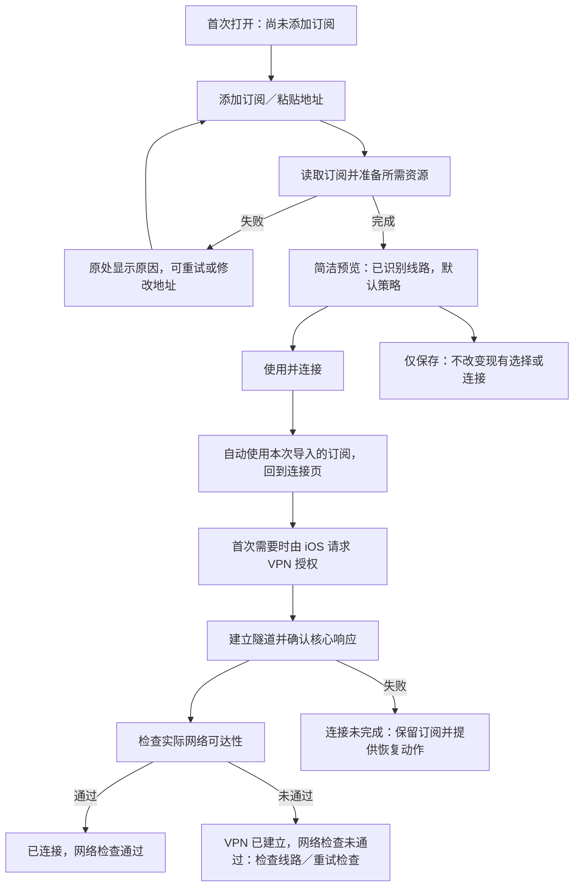

# Clash Dash 使用逻辑与交互重构方案

日期：2026-10-25。审计基线：0.2.0 (2)。状态：**P0 已落地到 0.3.0，真机通网实验通过；实现与边界见 [0.3.0 记录](RELEASE_0_3_0.md)。**

本轮用户反馈是“导入后不知道该选配置还是节点”，进一步确认主要卡点是操作顺序与对象关系。代码中确实存在对应的流程断点；目前不能仅凭这一反馈认定协议核心启动失败。后续 0.3.0 真机实验定位并修复了 Unix socket 路径超限；真实通网证据与本方案的规划内容分别记录。

本方案修正原始规划中将桌面“配置、策略、代理组”直接放在移动端一级界面的做法。目标是：**已有一个订阅地址的人，不需要理解配置和策略组，不需要跨 Tab 找开关，就能完成第一次连接。**

配套的会话内交互草图使用示例订阅与模拟授权，可体验“仅保存”“使用并连接”、离线选线路与取消；它不是手机中的正式界面。草图已检查这些分支及窄屏排版，原生 App 已实施第 12 节的主要 P0 路径；剩余范围见 0.3.0 记录。

## 1. 先把用户需要做的选择讲清楚

| 对象 | 对用户的含义 | 是否必须主动选择 |
| --- | --- | --- |
| 订阅 | 一套由服务商提供的线路与连接规则 | 添加第一份后，由明确的“使用并连接”动作自动选中 |
| 配置文件 | 订阅的一种技术载体，也可以是本地文件 | 普通订阅用户无需先理解；文件入口保留 |
| 线路／节点 | 订阅中连接到某个服务器的选项 | 首次连接不必手动选；有默认选择，用户可以按需要更换 |
| 策略组 | 按不同用途组织线路、自动选择与分流的机制 | 复杂配置的进阶能力，不作为首次连接前置知识 |
| 连接模式 | 按订阅规则分流，或让核心接管的流量统一走所选线路 | 默认按订阅分流；更改是可选操作 |
| 系统 VPN | iOS 承载网络流量的连接 | 用户点击连接后由 App 设置；首次可能需要系统授权 |

正确的先后顺序：**先有订阅，再建立连接。线路有默认值，手动选线路是可选操作。**

不能把“订阅、配置、节点、策略组”做成四个同等重要、都需要用户作答的选择题。

## 2. 当前代码中的具体断点

| 现状及证据 | 使用后果 | 重构要求 |
| --- | --- | --- |
| `ProfileStore.importConfiguration` 只有在没有已选配置时才设定 `selectedProfileID`；`AppModel.save` 保存后直接提示“可以连接了” | 新订阅可能只是入库，首页仍使用旧配置或直连样本 | 提交动作明确区分“使用并连接”与“仅保存”，返回确切的 profile/version；不能靠已有 activeProfile 推断导入目标 |
| `ProfileDetailView` 的“设为当前配置”藏在详情里；列表点击只是进详情 | 用户导入后还要发现一个隐藏的激活动作 | 使用入口直接可见；首次连接不进入配置详情 |
| `PolicyDetailView` 点击节点需要已连接；`AppModel.select` 只走扩展 IPC | 想先选节点再连接的人陷入循环 | 断开时可保存下次使用的选择；连接后才进行实际网络测速 |
| `AppModel.quickGroup` 取第一个可选组 | 首页可能显示某个视频、游戏或其他局部用途的组，误当成整体线路 | 依据实际模式和配置结构决定摘要；复杂分流不能假装只有一个全局节点 |
| `ImportView` 的读取、节点转换、provider 下载、数据库下载与核心校验共用一个 loading | 长时间等待时不知道发生了什么，误以为卡死 | 展示真实阶段；可度量的下载显示真实进度；可取消、可重试 |
| 预览堆放静态节点、组、规则、远程资源和大量底层警告，保存按钮在长表单底部 | 关键信息和下一步被技术细节淹没 | 主体只显示识别结果和必要问题；详细兼容性折叠；主按钮固定在底部 |
| `summary.nodes` 只统计静态节点 | provider 配置可能被显示为“0 个节点”，实际却有资源中的节点 | 在资源准备后生成统一的已解析节点摘要；未解析时说明正在读取，不能等同于零节点 |
| 首页绿色、成功触感主要取决于系统 `.connected` | 可能把隧道建立和实际通网混在一起 | 分别表达系统隧道、核心响应和网络检查结果 |
| `activeSummary` 来自所选配置的最新版本；更新后运行核心仍是旧版本 | 规则数量、线路信息可能来自新版本，实际连接使用旧版本 | 连接时以运行中的 profile/generation 为准，更新单独显示“待重新连接” |
| 直连诊断样本与普通订阅同等出现，并能成为默认配置 | 用户以为自己在使用代理，实际选择了开发样本 | 诊断入口放到开发工具；直连配置明确标注，不能冒充代理订阅 |
| 故障主要通过统一“操作未完成”弹框或转瞬即逝的提示反馈 | 用户只看到失败，不知道该改订阅、换线路还是授权 | 错误留在相关页面，包含具体阶段与下一步动作 |

对应源文件：`ClashDashApp/ProfilesView.swift`、`OverviewView.swift`、`PoliciesView.swift`、`AppModel.swift`、`TunnelController.swift`，以及 `Packages/ClashDashKit/Sources/ClashDashKit/ProfileStore.swift`。

以上是代码可以确认的使用逻辑问题。真实 VPN 的签名、扩展启动、DNS、内存和网络故障仍须独立验证，不能用改文案来代替。

## 3. 新的信息架构

保留四个稳定的 Tab，改为面向任务的名称：

| Tab | 主要回答的问题 | 主要内容 |
| --- | --- | --- |
| 连接 | 我现在连上了吗，正在用哪个订阅？ | 连接状态、主按钮、使用中的订阅、线路或分流摘要、错误与恢复、简洁流量 |
| 线路 | 我想换到哪里，或者调整哪类用途？ | 当前订阅的线路选择；复杂分流的用途与策略；连接后测速 |
| 订阅 | 我的订阅是什么，怎么更新和切换？ | 添加、使用、更新、额度、到期信息；详情中才出现版本和原文 |
| 设置 | 外观、连接行为和排障在哪里？ | 外观、诊断、隐私、许可；进阶能力分组 |

规则全文、原始 YAML、完整代理组参数、provider、核心版本和调试信息进入详情。它们不是首次使用的必经页面。

Apple 建议 Tab 用于顶层导航，并保持位置与可用性稳定；因此不把“连接”做成点击即执行的 Tab，不在无订阅时禁用“线路”Tab，而是在页面中解释并提供添加入口。[Apple：Tab bars](https://developer.apple.com/design/human-interface-guidelines/tab-bars)

## 4. 第一次使用：一条连续路径



### 4.1 空首页

- 标题“开始连接”。正文“添加你的订阅，导入后即可连接。”
- 唯一主按钮“添加订阅”。次要入口“导入文件或节点”。
- 不显示没有意义的零流量图、空代理组或未运行核心参数。
- 没有代理订阅时，不因开发诊断样本存在就显示“准备就绪”。

### 4.2 添加与读取

- 首屏一个输入框，按钮“粘贴”和“继续”。自动识别 HTTPS、支持的订阅安装链接和分享链接。
- 用户无需先选择 Clash、Shadowrocket 或具体协议。格式说明放在帮助中。
- 文件、节点内容入口放在同一个添加流程内的次要区域，不打开多层模态。
- URL 不合法时在输入框下说明；服务器返回登录页时说明“这是管理页面，请复制订阅地址”。
- 网络错误时保留输入，提供“重试”；不要求重新粘贴。

读取期间展示实际阶段：读取订阅 → 识别线路 → 准备规则与数据库 → 检查配置。数据库等下载有真实字节数时显示进度，没有可度量信息时只显示阶段和活动指示器。取消应停止后续提交，晚到的下载结果不能自动保存或连接。

### 4.3 导入预览

首屏内容：订阅名称、来源站点、已识别线路数量、默认使用方式。名称自动填充，可选编辑。

必要提示示例：“有 18 条桌面专用规则不会在 iPhone 使用，其余规则已保留。”详细规则、数据库和格式说明折叠。

- 未连接：主按钮 **“使用并连接”**。
- 已连接另一个订阅：主按钮 **“切换并重连”**，旁边说明将短暂中断当前连接。
- 次按钮 **“仅保存”**，明确不替换已有选择或正在运行的连接。
- 两个按钮固定在安全区域内，适配键盘和大字体，不要求滚动到全部技术提示末尾。
- “已识别 36 条线路”不写成“36 条可用线路”；导入检查不能证明远端服务都可达。

### 4.4 提交后的去向

点击“使用并连接”后：保存本次结果 → 选中返回的订阅 ID/version → 关闭导入页 → 切到连接页 → 执行连接。用户不用手动找“设为当前配置”。

连接由独立的协调器持有，不能因为导入 sheet 关闭导致 `.onDisappear` 取消连接任务。关闭表单和取消连接是两个不同动作。

点击“仅保存”后返回订阅列表，提示“已保存”，对应卡片提供“使用并连接”。不能提示“可以连接了”却把首页留在另一个旧订阅上。

## 5. 每天使用的首页

首页从上到下只承担四件事：

1. 连接状态与主按钮。
2. 使用中的订阅，可点开切换。
3. 线路或分流摘要，按需要调整。
4. 真实流量与近期问题，连接后才出现有意义的数据。

### 5.1 导入后、未连接

示意：

```text
未连接
已准备好使用“我的订阅”

[ 连接 ]

使用的订阅    我的订阅        >
连接方式      按订阅分流
线路策略      使用订阅默认选择  >
```

用户可以直接连接，也可以先点“线路策略”预选。没有“先选择节点才能连接”的隐藏前提。

### 5.2 连接过程中

保持原页面和订阅名称稳定，显示当前阶段；主动作是“取消连接”。系统授权、核心启动与网络检查不能统一成一个无限旋转的“正在连接”。

系统确认前显示“如出现系统提示，请允许添加 VPN 配置”。不能假设 App 可以精确读取系统授权弹窗是否已经展示，也不绕过 iOS 授权。

### 5.3 已连接

```text
已连接
网络检查通过 · 09:15

[ 断开连接 ]

正在使用      我的订阅        >
分流方式      按订阅分流      >
线路策略      按不同用途选择    >

下载 / 上传 / 已连接时间
```

网络可用信息带检查时间，表示测试目标在当时可达，不宣称所有网站和所有协议均通过。

### 5.4 切换订阅

从首页订阅行打开选择 sheet；选项直接显示名称、线路数量、准备状态和当前使用标记。

- 未连接：选中后保存下次使用的订阅，返回首页即可连接。
- 已连接：动作明确写“切换并重连”，按停止旧连接 → 等待断开 → 启动新版本顺序执行。
- 新连接失败：保留两个订阅，显示“切换失败，之前的订阅仍保留”，提供“恢复之前的连接”和“重试新订阅”。
- 不自动删除旧配置，不悄悄切换到不同的代理或直连路径。

## 6. 线路怎么选：简单订阅与完整分流分开表达

### 6.1 单节点集合／只有一个手动选择组

可以直接显示“下次使用：日本 01”，连接后改为从核心读回的“当前生效：日本 01”。列表提供名称、地区信息（来源实际提供时）、协议和延迟。

断开时选择只保存偏好，立即显示选中状态与“连接后使用”。无需先启动 VPN。连接后选择则等待核心回执，再显示生效；失败保留上一个确认值。

### 6.2 含自动选择组的订阅

只有配置确实提供 url-test、fallback 等自动策略时，才显示对应的“自动选择”。解释应为“由订阅策略管理”，不能泛称“自动选择最快节点”。

首次保留订阅默认策略，节点选择仍然可选。自动策略的当前实际节点以核心运行结果为准。

### 6.3 完整 Clash 配置，包含多个用途和策略组

规则模式下，不同请求可能走不同的组，没有一个必然适用于整个设备的“当前节点”。不能简单取 YAML 中第一个组，也不能直接把全部规则改成一个 MATCH 来制造简单界面。

- 首页显示“按订阅分流”，入口叫“线路与分流”。
- 线路页先展示订阅默认使用方式，再按用途展开可调整的策略。
- 只有能确定唯一主选择组时，才给出单一快捷线路入口；不能确定时不猜。
- 全部代理组与规则放在“高级策略”中；用户不进入这里也能首次连接。
- 全局模式调整的是核心的 GLOBAL 选择；规则模式中的某一用途组不是 GLOBAL。二者在状态与文案上分开。

### 6.4 测速

当前实现依赖运行中的扩展，首期保持“连接后测速”。断开时仍可选择线路，测速处说明原因，不能让整个列表看起来不可操作。

延迟不等于带宽，不伪造未测试的数值；批量测试可取消，结果标记时间。是否实现连接前独立测速作为后续技术项目评估，不以它阻塞首次连接闭环。

## 7. 状态、按钮和错误必须对应

| 状态 | 页面表达 | 主按钮／恢复动作 |
| --- | --- | --- |
| 没有订阅 | 尚未添加订阅 | 添加订阅 |
| 订阅正在准备 | 正在读取线路／准备数据库等真实阶段 | 取消，可重试 |
| 订阅准备完成、未连接 | 已准备好使用某订阅 | 连接 |
| 配置读取／检查失败 | 本次导入未完成，显示原因 | 重试、修改地址；已有订阅仍保留 |
| 保存 VPN 设置中 | 正在设置系统 VPN，如出现提示请允许 | 取消；拒绝后可重新发起 |
| 扩展启动中 | 正在建立连接 | 取消连接 |
| 系统 connected、核心未响应 | VPN 已建立，正在确认核心 | 等待有界时间；超时显示核心未响应 |
| 核心正常、检查中 | VPN 已建立，正在检查网络 | 断开连接 |
| 检查通过 | 已连接，网络检查通过并标记时间 | 断开连接 |
| 检查未通过但隧道仍运行 | VPN 已连接，网络检查未通过 | 断开连接；问题卡片提供检查线路、重试检查 |
| 正在断开 | 正在断开 | 禁止重复启动或切换提交，等待终态 |
| 网络切换中 | 正在恢复连接，暂未确认网络 | 取消连接；不能继续显示陈旧的绿色健康状态 |
| 扩展启动失败 | 连接未完成，订阅已保留 | 重试连接、查看原因／更换线路 |

底层至少分别保存三类事实：系统 VPN 状态、核心会话状态、网络检查状态。视图根据它们生成面向用户的表达，而不是用一个 `.connected` 替代所有成功条件。

`NETunnelProviderManager` 管理的是系统 VPN 配置与连接；它不等同于 App 中保存的多份订阅。`NEVPNStatus` 提供系统连接阶段，实际网络健康仍须单独测量。[Apple：NETunnelProviderManager](https://developer.apple.com/documentation/networkextension/netunnelprovidermanager)、[NEVPNStatus](https://developer.apple.com/documentation/networkextension/nevpnstatus)

### 7.1 失败信息的写法

用“发生在哪一步 + 保留了什么 + 下一步动作”，技术详情作为可展开的附加内容。

| 问题 | 用户看到的表达 | 可执行动作 |
| --- | --- | --- |
| 订阅 HTTP 401/403 | 订阅访问被拒绝，请检查链接或服务有效期 | 修改地址、重试 |
| 返回 HTML 管理页 | 这是服务管理页面，请复制其中的订阅地址 | 返回修改 |
| 必需数据库下载失败 | 配置还需要准备数据库，当前下载失败；旧版本未替换 | 重试资源准备 |
| 系统 VPN 设置被拒绝 | 未完成系统 VPN 设置 | 重新发起设置、查看手动说明 |
| 核心启动失败 | 连接未完成：核心未正常启动 | 重试、展开脱敏原因 |
| 某节点 HTTPS 失败 | 这条线路暂未通过网络检查 | 更换线路、重试检查 |
| HTTPS 可用、UDP 不通过 | 网页连接正常，UDP 功能尚未通过 | 查看诊断、选择另一条线路；不泛称整份订阅不可用 |

不把首次网络检查失败当成导入失败，不清空已保存订阅；不以关闭 TLS 校验或跳过必需数据库来换取“连接成功”。

## 8. 订阅更新、历史和运行版本

- 更新是准备新版本，不能改变已经运行的版本。
- 连接页从运行中的 profile/generation 取得线路和规则摘要。
- 更新完成显示“更新已保存，重新连接后使用”，提供明确的“重新连接”动作；不只给一条 3 秒后消失的提示。
- 下次连接使用所选的新版本。若用户恢复历史版本，要明确“恢复并重新连接”或“下次连接使用”。
- 用户修改偏好时只影响目标订阅，不能把旧会话的迟到回执写入新订阅。
- “最近成功启动”和“最近网络检查通过”分别记录。已有 `lastKnownGood` 不能直接包装为已验证 Internet 可用。

## 9. 符合 iOS 使用习惯的界面与交互

- 使用系统导航、表单、列表、sheet、选择标记和 SF Symbols。自定义只用于状态呈现与布局，不重做系统控件。
- 添加订阅是一个范围明确的短流程；选择订阅／线路用短 sheet，复杂详情用导航页，避免一层 sheet 套一套完整应用。[Apple：Modality](https://developer.apple.com/design/human-interface-guidelines/modality)
- 长操作提供真实阶段、恰当的进度和取消；不能用虚假的百分比制造完成感。[Apple：Progress indicators](https://developer.apple.com/design/human-interface-guidelines/progress-indicators)
- 成功与失败尽量就地、持续显示。重要状态同时有文字与图标，不能只用红绿颜色；仅需要用户及时决定的重要问题才弹框。[Apple：Feedback](https://developer.apple.com/design/human-interface-guidelines/feedback)
- 输入使用正确键盘、主动粘贴、自动关闭不必要的键盘；不后台读取剪贴板。
- 主要触控区域至少 44pt；连接主按钮按现有 52pt 下限规划。大字体与横屏下仍能找到提交／取消动作，底部操作尊重安全区域。[Apple：Buttons](https://developer.apple.com/design/human-interface-guidelines/buttons)
- 连接成功触感不在保存订阅时触发；减弱动态效果下保持反馈含义。

这些是结合 Apple 指南与本产品任务作出的设计取舍；“四个 Tab 的中文命名”“使用并连接”等具体决定属于 Clash Dash 方案，不是 Apple 要求代理 App 必须这样命名。

## 10. 工程实现约束

### 10.1 明确的动作与返回值

建议新增 `ImportCoordinator` 与 `ConnectionCoordinator`，视图不拼接零散的 busy/loading 状态。

```text
prepareImport(source) -> ImportPreview
commitImport(preview, intent: useAndConnect | saveOnly) -> ImportCommit
ImportCommit = profileID + generationID + 更新后的索引

chooseProfile(profileID, connectNow)
chooseRoute(profileID, groupID, memberID)
connect(profileID, generationID, attemptID)
disconnect(attemptID)
refreshSubscription(profileID) -> 新版本／待应用更新
```

导入保存不能只返回 ProfileLibrary，然后让调用方再次读取可能仍指向旧订阅的 activeProfile。使用动作应消费本次提交的明确 ID。

### 10.2 状态模型

- `ImportState`：输入、读取、资源准备、校验、预览、提交、失败。
- `DesiredConnection`：用户接下来要使用的 profile、generation、模式与偏好。
- `RunningSession`：核心确认的 profile、generation、session、实际组选择。
- `ConnectivityState`：未检查、检查中、通过、未通过及时间。
- `PendingUpdate`：所选最新版本与运行版本的差异。
- `PrimaryRoutePresentation`：单一可选线路、配置自动策略、多组分流、仅直连、尚未准备。

现有存储字段可以兼容映射，不必为改名称强制丢弃数据。逻辑上必须分开“准备使用”和“实际生效”。

### 10.3 并发与取消

- 同一时间只执行一个连接／切换／断开事务；切换包括 `.disconnecting` 阶段。
- 每次连接有 attempt ID，超时、用户取消与迟到的系统回调不能重新激活旧连接。
- IPC 校验 request/session/generation；快照及错误均只更新所属会话。
- 离线选节点先验证成员关系，再存入偏好；连接后选节点先收到核心成功回执，再更新“已生效”。
- 设置的偏好应显示为默认值或下次值；运行值来自核心，不能直接拿本地偏好代替运行事实。
- 不改动上游订阅原文。移动适配和偏好覆盖单独保存；不能为了一个“当前节点”入口抹掉完整分流。
- 连接阶段的超时预算先根据真机记录校准；产品必须有终态和恢复动作，不显示无期限旋转。网络检查单项可先按 12–15 秒规划，属于待实测参数。

## 11. 现有数据的过渡

用户已经导入的订阅、加密密钥、原文、历史版本与选择应保留，不能要求删 App 重来。

- 识别确切的内置直连 fixture，可依据保存原文哈希与内置 fixture 匹配标记为诊断来源；不要仅凭中文名称删除或隐藏用户文件。
- 仅直连文件是有效配置，但显示“仅直连，不提供代理线路”，不作为普通用户的代理推荐。
- 若当前未连接、旧默认是诊断样本而已有真实订阅，首页提供“使用你的订阅连接”的直接入口；不用用户自己找隐藏的详情按钮。
- 若 VPN 正在运行，先还原真实运行状态，不自动选择另一个订阅或改动路由。
- provider 节点计数、来源类型等新字段采用可选字段和兼容迁移，不破坏旧信封解密。

## 12. 实施顺序与验收

### P0：先消除首次使用断点

1. 导入返回明确 profile/version；完成“使用并连接”“仅保存”的不同语义。
2. 打通首次订阅 → 使用 → 系统授权 → 实际隧道 → 网络检查，不跨 Tab、不要求进详情。
3. 首页明确正在使用的订阅，提供直接切换入口；移走面向普通用户的诊断样本入口。
4. 支持未连接时预选手动线路，连接时应用；不以测速作为选线路前提。
5. 修正系统、核心、健康检查与失败恢复的状态展示。
6. 在 iPhone 完成真实首次使用验证，保存阶段与脱敏失败原因。未验证之前不宣称“导入后连接已解决”。

### P1：完整分流与日常管理

实现简单线路／自动策略／复杂分流的不同呈现，provider 节点摘要，更新待应用、版本恢复与运行快照一致性；再完善层级、留白与动效。

### 必须通过的体验用例

| 用例 | 验收结果 |
| --- | --- |
| 新用户只持有一条订阅 URL | 不懂配置和策略组也能完成首次连接，不跨 Tab 找激活开关 |
| 手机已有诊断样本，再导入真实订阅 | “使用并连接”连接本次新订阅，不误连旧样本 |
| 第二份订阅选择“仅保存” | 现有选择和运行连接均保留；卡片显示可直接使用的动作 |
| 未连接时选择一条线路 | 立即显示下次选择，重启 App 保留，连接后核心读回匹配 |
| 31 个策略组的完整配置 | 保留原分流；首页不把第一个局部组冒充整个设备的线路 |
| provider 配置没有静态节点 | 资源准备后显示实际识别结果，不错误显示无节点或阻止使用 |
| 拒绝首次系统授权 | 显示可恢复状态，订阅仍在，可再次发起；不无限旋转 |
| 点击连接后取消、立刻再次连接 | 最终状态和最新意图一致，没有旧回调把已取消的任务复活 |
| 更新正在运行的订阅 | 仍显示旧运行版本，明确提示更新待应用；重连后显示新版本 |
| HTTPS 正常但单节点 UDP 失败 | 区分检查结果，不把整个订阅、隧道和所有节点一起判为失败 |
| 切换订阅后新连接失败 | 两份订阅保留，能恢复之前连接，用户知道当前尚未连上 |
| 大字体、横屏、VoiceOver | 主要动作可达、选中和错误可读，不能依赖颜色或长按发现关键功能 |

原有 19 项共享测试、47 项导入检查、12 组 macOS 协议实验和 UI 导航测试不能替代以上体验与 iPhone VPN 验收。新增自动化应围绕“导入的确切订阅真的被连接”“离线偏好实际应用”“取消不复活”等行为，而不是只检查页面元素存在。
