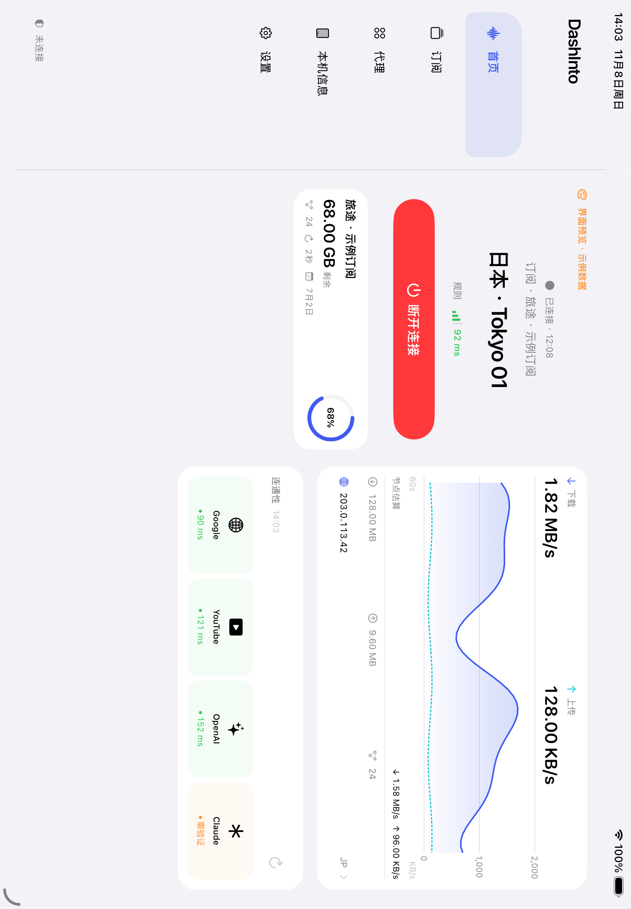

# iPad 布局

iPad 与 iPhone 共用订阅、节点选择、连接、测速及设置，不维护两套业务流程。最低支持 iPadOS 17。

## 布局规则

- 窗口宽度至少 1,000 pt：左侧展示五个导航入口和 VPN 状态，内容区域隐藏重复的系统 Tab。使用同一个 TabView，切换窗口尺寸时保留搜索和页面导航。
- 更窄的窗口：使用系统 Tab 导航，适合竖屏、分屏及窄窗口。按实际窗口宽度判断，不读取屏幕固定尺寸。
- 首页内容区域至少 740 pt 且有订阅：双栏。未连接时，左侧为计划节点与连接按钮，右侧为订阅概览；连接后，左侧保留连接操作及订阅，右侧为实时流量、出口 IP 与网站连通性。
- iPad 流量图高度为 144 pt，保留最近 60 秒曲线与触摸查看采样值。
- 首页窄屏：继续按连接、流量、订阅、网站的顺序纵向排列。无订阅时保留居中的单一导入入口，不显示空的监测卡片。
- 订阅、设备、设置列表使用最长 760 pt 的阅读宽度；代理列表为 880 pt，给长节点名称留出空间。导航栏和系统返回按钮不随列表缩窄。
- 辅助功能大字体：收起固定侧栏，首页使用单栏，允许纵向滚动。沿用 VoiceOver 标签、44 pt 操作区域和减少动态效果设置。

## 不变的行为

导入确认、订阅选择、节点策略链、规则/全局/直连模式、延迟排序与测速、连接取消、诊断及更新入口均沿用原实现。横竖屏变化不会重连 VPN。iPad 的“本机信息”入口使用 iPad 图标。

## 验证

`IPadLayoutTests` 覆盖横竖屏侧栏切换、五个入口、导入弹窗、保留已打开的设置详情、代理搜索文本和测速结果弹窗，以及使用明确标注示例数据的双栏首页。iPhone 使用已有核心交互回归。真机网络结果与界面预览分开记录，不用模拟数据宣称 VPN 通网。

## 界面效果

以下为模拟器的明确标注示例数据，不代表真实 VPN 连接。

[深色外观](screenshots/054-iPadDashboardDark.png) · [竖屏布局](screenshots/054-iPadDashboardPortrait.png)
